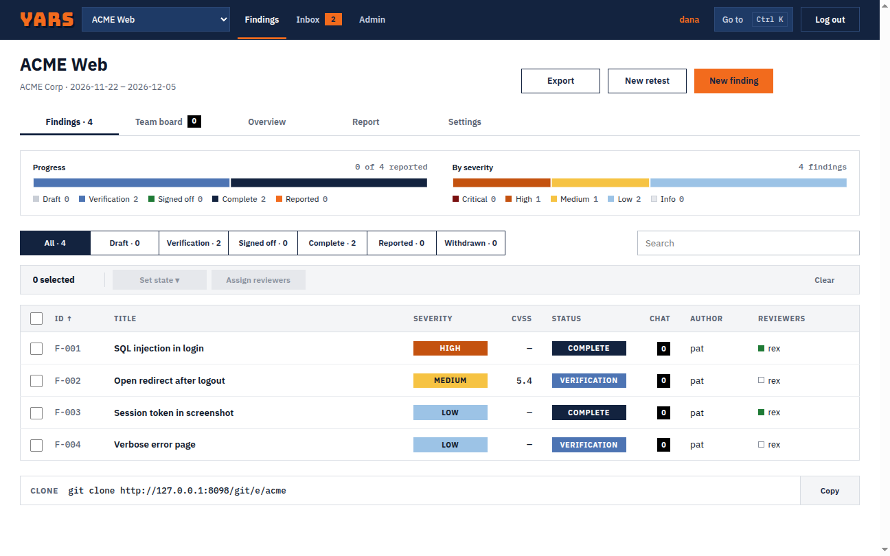
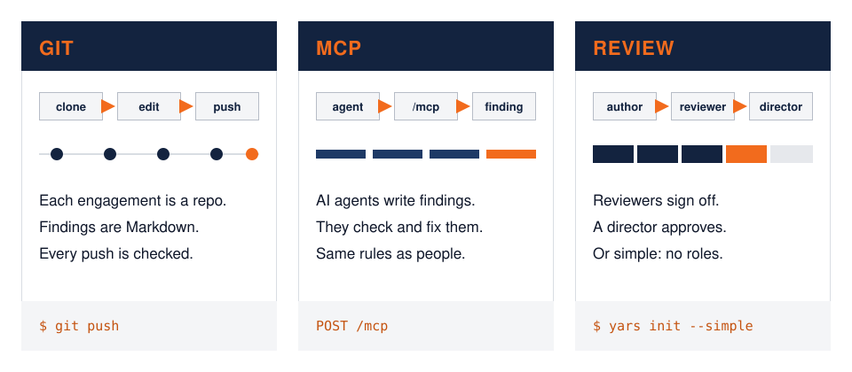

<p align="center"></p>

<p align="center"><b>Yet Another Reporting System.</b> One finding, one Markdown file. A web app on top.</p>

<p align="center"></p>

## Three ways in

<p align="center"></p>

- **Git.** Each engagement is a repo. Clone it, write, push. The server checks every push. → [git.md](docs/git.md)
- **MCP.** AI agents write and fix findings. They follow the same rules as people. → [mcp.md](docs/mcp.md)
- **Review.** Draft → verification → signed off → complete → reported. Reviewers sign off. A director approves.

## Start

Needs Go 1.27.2 or later.

```sh
go install github.com/abno525/yars/cmd/yars@latest
yars init data
echo 'change-me-now' | yars useradd --data data --role director --admin alice
yars serve --data data
```

`go install` puts `yars` in `$(go env GOPATH)/bin`. Have that folder on your `PATH`.

Open <http://localhost:8080>.

## Simple mode

Working alone, or in a team of two? Skip the roles.

```sh
yars init --simple data
echo 'change-me-now' | yars useradd --data data --admin alice
```

Draft → complete → reported. Admin or not. That's all.

## Handy commands

| Command | Does |
|---|---|
| `yars use data` | Makes `data` the default, so `--data` can go. |
| `yars hook install` | In a clone: the server checks each commit. |
| `yars unlock alice` | Ends a lockout after 5 wrong passwords. |
| `yars backup --out yars.zip` | Backs up everything. Safe while it runs. |
| `yars seed --data demo` | Fills a demo folder (`--simple` too). |

The demo accounts are `dir1` (admin), `rev1` and `pen1`; with `--simple`, `dir1` (admin) and `dir2`. `seed` prints their password: a random one each run. It makes 2 engagements of 20 findings; `--engagements`, `--findings` and `--messages` change that.

## Docs

[Wiki](https://github.com/abno525/yars/wiki) · [Deploy](docs/deploy.md) · [Git](docs/git.md) · [MCP](docs/mcp.md) · [Rules](docs/rules.md) · [Config](docs/config.md) · [Exporters](docs/exporters.md) · [Webhooks](docs/webhooks.md) · [Known limits](docs/known-limits.md)

## License

[AGPL-3.0](LICENSE). Run a changed YARS for others, and you share your changes with them.
